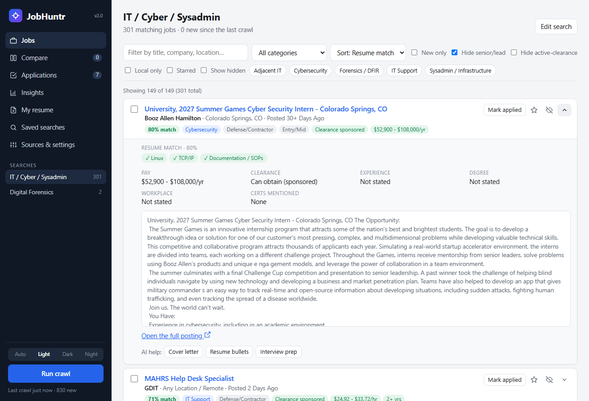
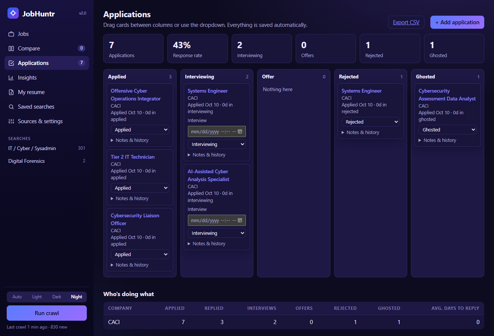
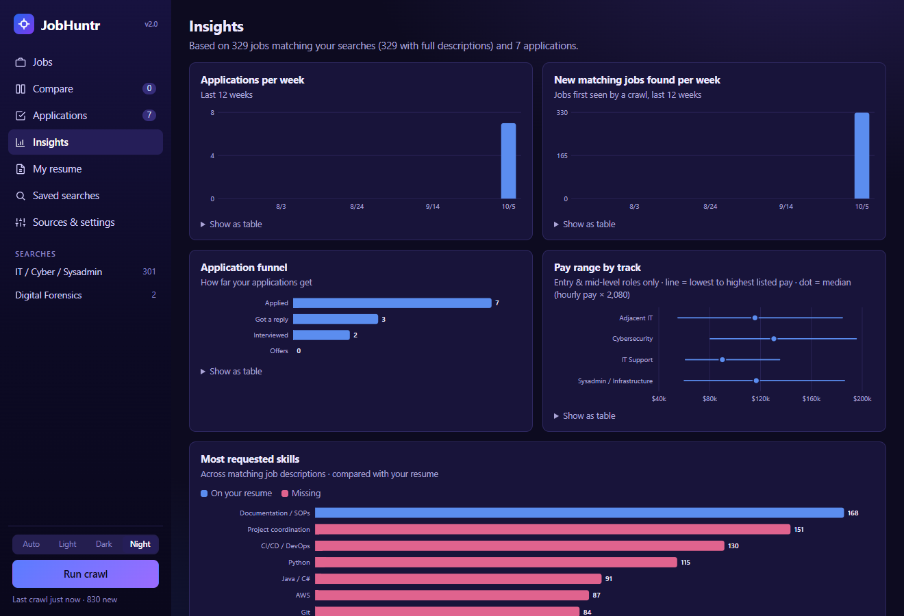

# JobHuntr


A Windows desktop job-hunting app. It crawls employer career sites directly (hospitals, government, defense contractors and private companies), scores each job against your resume, and tracks every application from "applied" to "offer" (or "ghosted").

It works in any US metro area: tell it where you're looking and it searches every employer for jobs there (plus remote jobs if you want them). It is tuned for IT / cybersecurity roles out of the box, and the employers and search terms are all configurable.



## Features

**Finding jobs**
- **Direct-from-employer crawling.** Adapters for 7 applicant-tracking platforms (Workday, Oracle Cloud HCM, iCIMS, Radancy TalentBrew, NEOGOV, Jibe, Taleo) plus the USAJobs API. It ships with nationwide employers (defense contractors, hospital systems, large private companies); you can add any Workday employer by pasting its careers URL, or drop in a pack of local employers (see below).
- **Daily automatic crawl.** A Windows scheduled task runs a crawl each day and shows a toast notification like "4 new job matches: …". If the app is already open, the scheduled crawl hands off to it so only one crawl runs.
- **Saved searches.** Searches use either a built-in IT/cyber title classifier or your own keywords, with exclusions, category filters and optional full-description search. One crawl feeds every search.
- **Duplicate grouping.** Contractors often repost the same job under different requisition numbers; those postings collapse into one entry ("×4 postings").

**Deciding where to apply**
- **Resume match score.** Upload a resume (PDF, DOCX or TXT). A vocabulary of about 90 IT/security skills is matched against each job description, giving a score plus the exact skills the job wants that you're missing.
- **Description analysis.** Rules pull out pay range, security clearance (*active required* vs *will sponsor*), years of experience, degree, certifications (Security+, DoD 8140, CISSP…), workplace type and recruiter contacts. A person-plus icon marks postings that name a recruiter.
- **Side-by-side compare.** Compare up to 4 jobs at once, with a fit check (clearance, experience, Security+) and resume match.

**Tracking applications**
- **Kanban tracker.** Columns run Applied → Interviewing → Offer / Rejected / Ghosted, with drag-and-drop, notes and full status history.
- **Reminders.** It nudges you to follow up after N days and suggests "ghosted" after M days. Interview dates appear on an upcoming list and export to your calendar (`.ics` with a 1-hour alarm).
- **Insights dashboard.** Charts show applications per week, new jobs per week, an application funnel, pay ranges by track and the most-requested skills (with ones you have vs. are missing). Every chart has hover tooltips and a table view.
- **CSV export.**





## Your area and local employers

On first run JobHuntr asks for your city, state and any nearby towns or bases that should count as local. Everything is searched relative to that area and can be changed in **Sources & settings**.

The bundled employers hire nationwide. To add employers specific to your area (a city government, a local hospital, a regional bank), either paste Workday career links in the app, or create a personal pack at `%APPDATA%\JobHuntr\my_sources.json`:

```json
{
  "region": {"city": "Denver", "state": "CO", "nearby": ["Aurora", "Lakewood"], "radius": 50},
  "area_exclude": [],
  "sources": [
    {"type": "neogov",  "name": "City of Denver", "category": "Government", "agency": "denver"},
    {"type": "workday", "name": "Example Bank", "category": "Private",
     "host": "examplebank.wd5.myworkdayjobs.com", "tenant": "examplebank", "site": "External"}
  ],
  "manual_links": [{"name": "Local hospital careers", "category": "Hospital", "url": "https://example.org/careers"}]
}
```

Every adapter type (`workday`, `oracle`, `icims`, `talentbrew`, `neogov`, `jibe`, `taleo`) can be used in a pack. The pack lives outside the repo, so local or personal setup never ends up in version control.

## Architecture

```
jobhuntr/
  __main__.py      entry point: local server + app window (Edge --app), headless --crawl for the scheduler
  web.py           Flask JSON API + static UI; window-lifecycle tracking so the server quits only when closed
  crawler.py       background crawl: concurrent source fetches, then detail fetches for matching jobs
  region.py        the user's area: local place names, search terms, link templates
  sources/         one adapter per ATS platform, each exposing fetch_jobs() / fetch_details()
  matching.py      IT title classifier, seniority/clearance tags, saved-search matching, duplicate grouping
  extract.py       fact extraction from descriptions (versioned: stored jobs are re-analyzed when rules change)
  skills.py        skill vocabulary + resume-vs-job scoring
  resume.py        text extraction from PDF / DOCX / TXT resumes
  ai.py            optional Claude API integration (Anthropic Python SDK)
  system.py        Windows Task Scheduler + toast notifications
  db.py            SQLite (WAL) schema, migrations and queries
  static/          single-page UI in plain JavaScript/CSS, no build step; hand-built SVG charts; light/dark
tests/             pytest: parser tests per platform against saved real responses, extraction, matching, API
```

- **Stack:** Python 3.12, Flask, requests, SQLite, vanilla JS. It is packaged as a single-file `JobHuntr.exe` with PyInstaller.
- **Reliability:** per-source error isolation and status reporting, retries with backoff, request timeouts, an offline banner with auto-reconnect, and WAF-specific request handling.
- **Testing:** the CI runs lint (pyflakes) and the test suite on every push. The site parsers are tested offline against fixtures captured from the real sites, so when a site changes its markup, a failing test shows exactly which one broke.

## Running

```bat
pip install -r requirements-dev.txt
python -m jobhuntr            :: opens the app window
python -m jobhuntr --crawl    :: one headless crawl (what the daily scheduled task runs)
python -m pytest              :: tests
build.bat                     :: builds dist\JobHuntr.exe
```

Federal jobs need a free USAJobs API key (https://developer.usajobs.gov/apirequest/). The optional AI features need an Anthropic API key. Both are entered in **Sources & settings**, and all data stays in `%APPDATA%\JobHuntr`.

## Notes

- Job data comes from the public job-search endpoints that each career site's own pages use. Crawling is rate-friendly: concurrency is capped and only matching jobs get a detail fetch.
- Sites that block automated access (some hospital systems and contractors) are listed in the app as links to check by hand, pre-filled with your area.
